# Daneel

**A personal assistant app for iPhone, powered by Claude Code on your own server — using your Claude Pro/Max plan, not pay-per-token API keys.**

Daneel is a small Progressive Web App (PWA) that you add to your iPhone home screen. Behind it there is no API key: every message runs `claude -p` (Claude Code in headless mode) on a Linux box you own, inside a folder that holds your long-term memory, skills and subagents. You get a chat with a real agent that can read and write files, run scripts and remember things — plus a native-feeling dashboard for your day, health, food and money.

> **Note on the screenshots:** every number, meal, habit, message and portfolio value shown below is **fake**, randomly generated by [`tools/demo-dati.py`](tools/demo-dati.py) for a separate demo instance. None of it is real personal data. The UI is in Italian because that is the author's language.

<p align="center">
  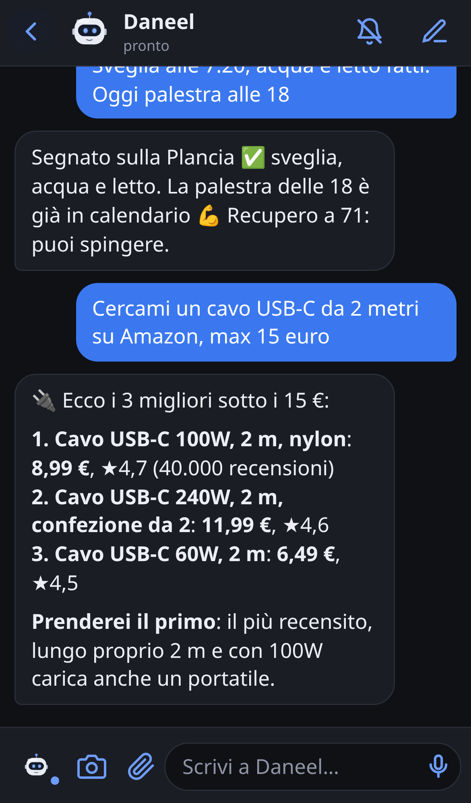
  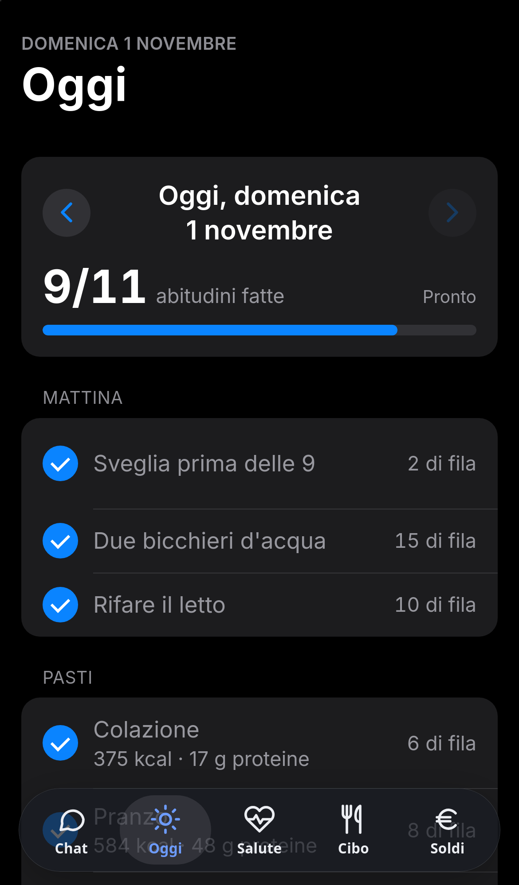
  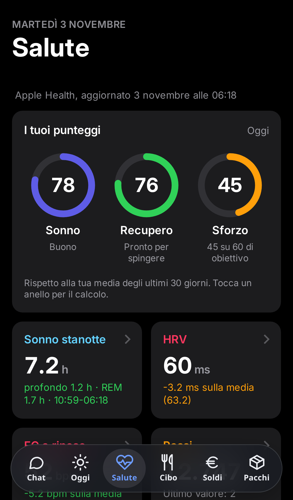
</p>
<p align="center">
  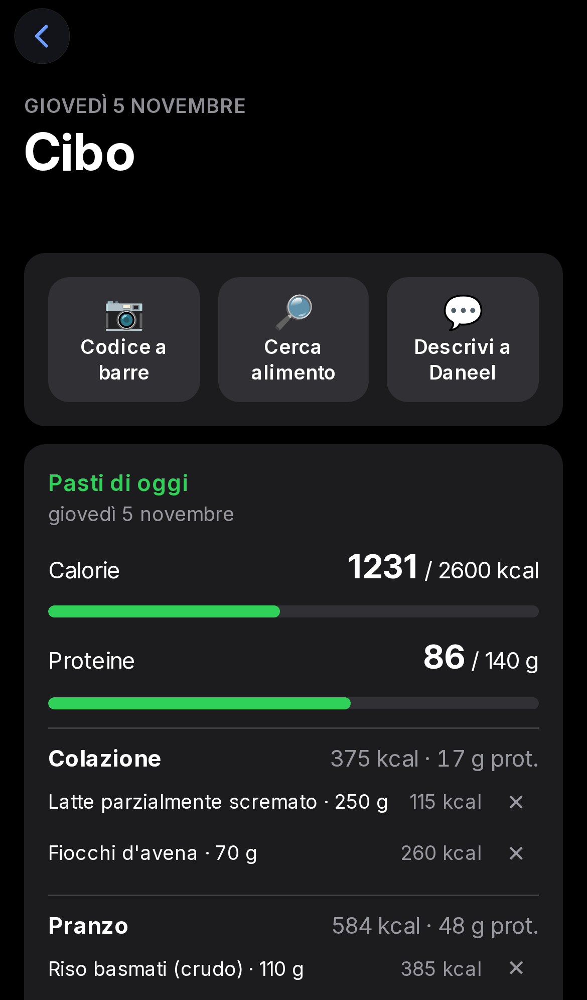
  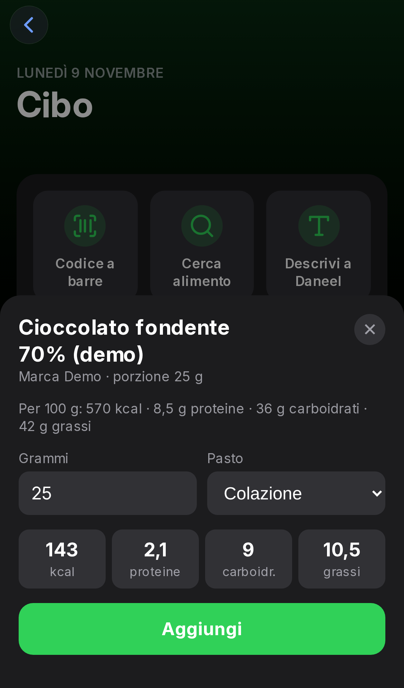
  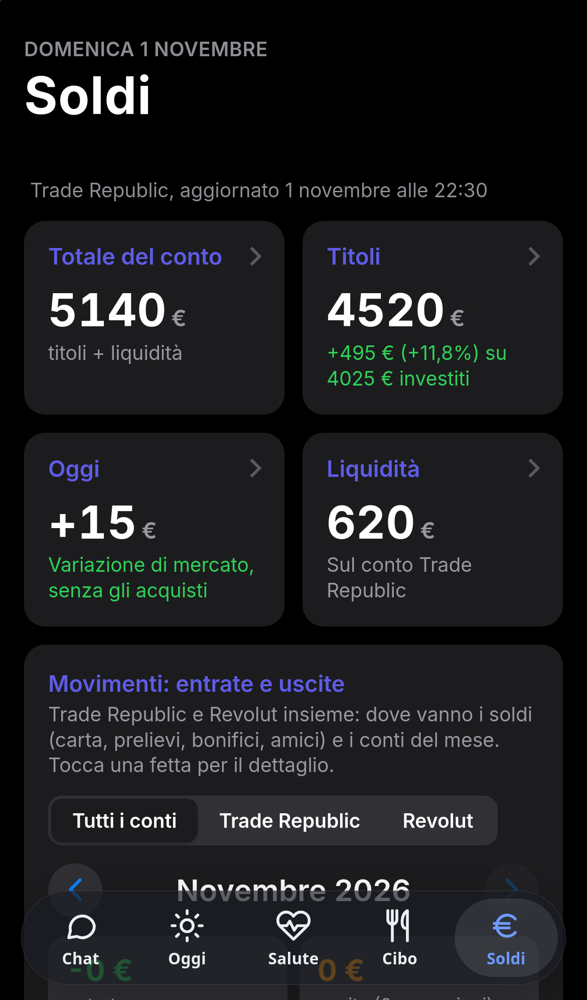
</p>

## Why

Claude Code already does everything a personal assistant needs: tools, memory files, skills, subagents, scheduled jobs. What it lacks is a pleasant way to use it from a phone. Daneel is that thin layer:

- **No tokens to pay for.** The server shells out to `claude -p --resume <session>`, so usage counts against your subscription limits like any other Claude Code session.
- **Your memory, your files.** Claude runs in a memory folder (an Obsidian vault in the author's case) with its own `CLAUDE.md`, so the app inherits every instruction, skill and subagent you've already set up.
- **Private by default.** The app listens on `127.0.0.1` and is exposed only inside a [Tailscale](https://tailscale.com) tailnet via `tailscale serve` (HTTPS), with a bearer token on top.

## Features

### Chat
- Streaming replies (Claude Code `stream-json` output → Server-Sent Events).
- Photos (camera or library) and **voice messages**, WhatsApp-style, transcribed on the server with Whisper.
- Turns run in the background: close the app mid-answer and the reply is still there when you come back.
- **Message queue:** keep writing while Daneel is answering; new messages (and scheduled jobs) wait their turn. Tap a queued message to cancel it.
- **Plan limits handled for you:** if Claude Code reports that the plan's usage limit is reached, the message goes back to the front of the queue and Daneel pauses until the reset time, then picks up where it left off and notifies you.
- **Subagents** from a picker next to the input box (Calendar, Mailman, Nutritionist, Scribe…): the message is routed to that subagent inside the same conversation.
- **Push notifications** (Web Push with VAPID): scheduled jobs and long tasks write into the chat and ping your phone. The first line of the reply becomes the notification title.

<p align="center">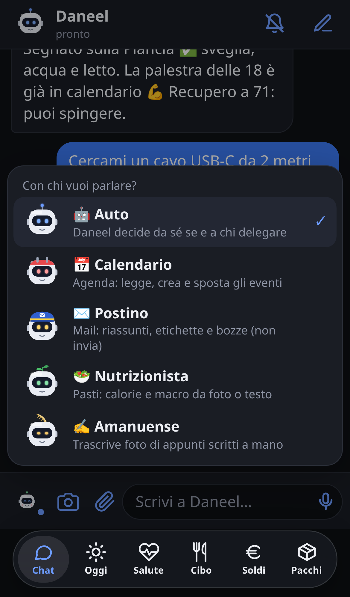</p>

### Dashboard ("Plancia"), split into tabs
A floating, translucent tab bar in the style of iOS 26 Health switches between the chat and five views of the same dashboard:

| Tab | What it shows |
| --- | --- |
| **Oggi** (Today) | Daily habits with streaks, meals checklist, **exam study planner**, calendar agenda (any iCal feed), trends, current book |
| **Salute** (Health) | **Sleep, Recovery and Strain rings** (0–100), sleep details, workouts (Hevy) and Muay Thai sessions |
| **Cibo** (Food) | Today's meals with calories and macros, **barcode scanner** and product search via [Open Food Facts](https://world.openfoodfacts.org) plus your own products, weight log |
| **Soldi** (Money) | Portfolio value, gains, cash and categorized spending across accounts |
| **Pacchi** (Parcels) | Paste a tracking code and get the parcel's route on a timeline, with a push notification at every stage |

The dashboard is a single HTML page originally built as a claude.ai Artifact. A tiny shim ([`plancia-shim.js`](server/static/plancia-shim.js)) replaces the Artifact database API with a local **SQLite** store, and updates are pushed live over SSE — when Claude writes to the dashboard from the chat, the page refreshes by itself.

### Health scores without a wearable subscription
[`punteggi.py`](server/punteggi.py) computes three scores from Apple Health data that an iOS Shortcut posts to the server:
- **Sleep** — duration vs. your need, deep and REM share, efficiency, schedule regularity.
- **Recovery** — resting heart rate and HRV against your 30-day baseline, plus last night's sleep.
- **Strain** — steps (or active calories), weight-training volume from Hevy and martial arts sessions; the daily target scales with recovery.

Tap a ring to see exactly how the number was calculated.

### Exam study planner
For every exam, [`studio.py`](server/studio.py) works out when to start studying and how to split the time — again with no model call:
- **Measures the course folder:** words and images of your notes file (projected to the end of the course, since it grows with every lecture), pages of exercise PDFs and past exam papers (counted once per date, even if you have several copies).
- **Turns material into hours** with stated assumptions: ~140 words per minute when reading to learn, a fixed time per exercise page, each mock exam worth its duration plus correction, a last week of review only. The total is checked against the official workload of the credits (1 ECTS = 25 h).
- **Fills your free days backwards** from each exam (at most 4 h of active study a day, minus calendar events), earliest exam first, and tells you how many hours are missing when time runs out.
- **Estimates that move:** while lessons go on, exercise hours blend what's in the folder with an expected share of the credits, and a daily history shows how the plan changed.

The card shows one lane per exam on a timeline (theory, exercises, mock exams, review, exam day); tap a lane for the phases, the measured material and plain study tips such as spaced reviews.

<p align="center">
  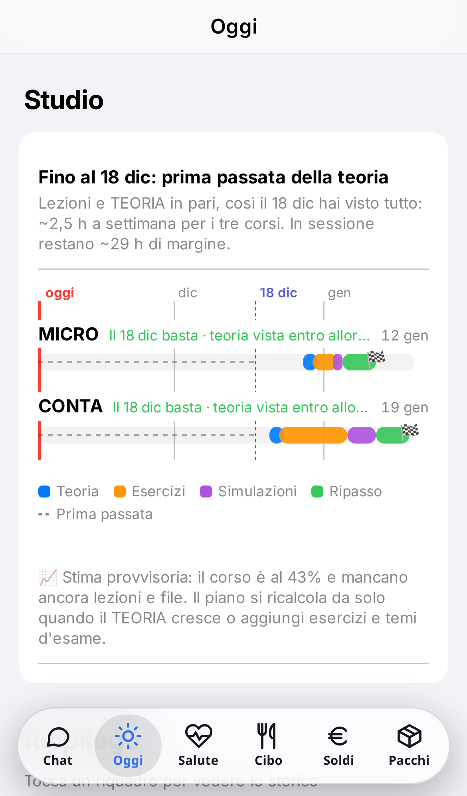
  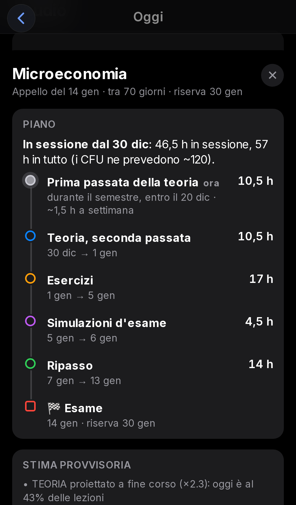
</p>

### Food logging without an LLM
Scan a barcode (ZXing in the browser) or search by name, pick the grams and the meal: [`cibo.py`](server/cibo.py) does the math from Open Food Facts' per-100 g values. No model call, no tokens — Claude is only needed when you want to log a meal from a photo.

If a barcode isn't on Open Food Facts, a **New product** sheet lets you type the values from the label, or jump to the chat and send Daneel a photo of the label to read them for you. Your products are stored in the dashboard database and are looked up first next time.

### Parcel tracking, free carriers first
[`pacchi.py`](server/pacchi.py) asks the free public endpoints of Poste Italiane/SDA and InPost first, and falls back to [Ship24](https://www.ship24.com) (free tier: 10 parcels a month, key in `~/.config/daneel-app/ship24`) for Amazon, DHL, GLS, BRT, UPS, Mondial Relay and the rest. An hourly check refreshes parcels in transit and sends a notification when the stage changes; delivered parcels disappear after 14 days. The morning mail summary adds tracking codes it finds with [`bin/pacco`](bin/pacco).

<p align="center">
  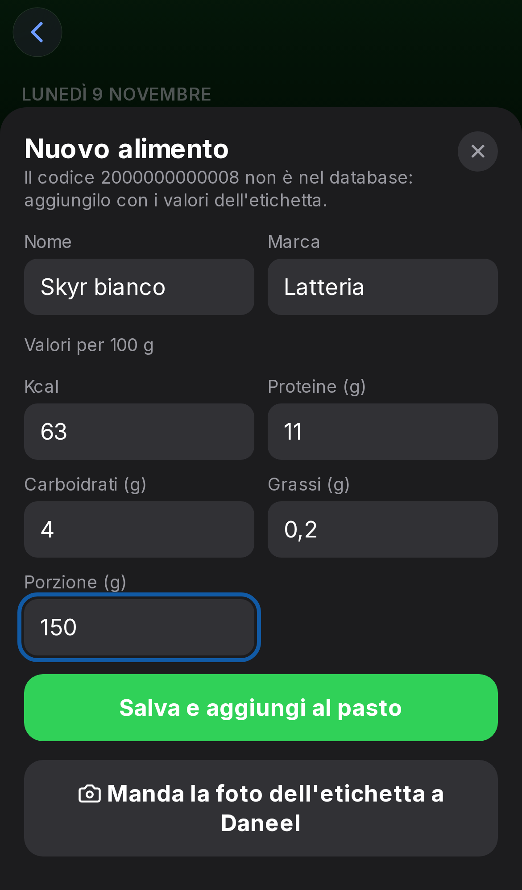
  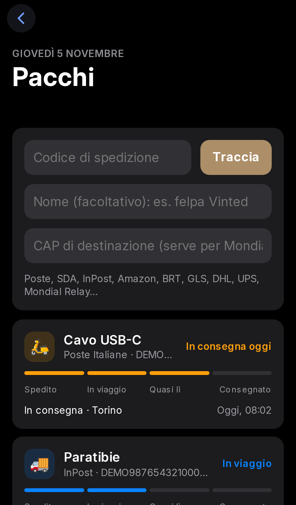
</p>

### The mascot
Daneel has an animated robot face that reacts to what's happening (calm, listening, thinking, talking, happy, sleeping, confused), and each subagent has its own look.

<p align="center">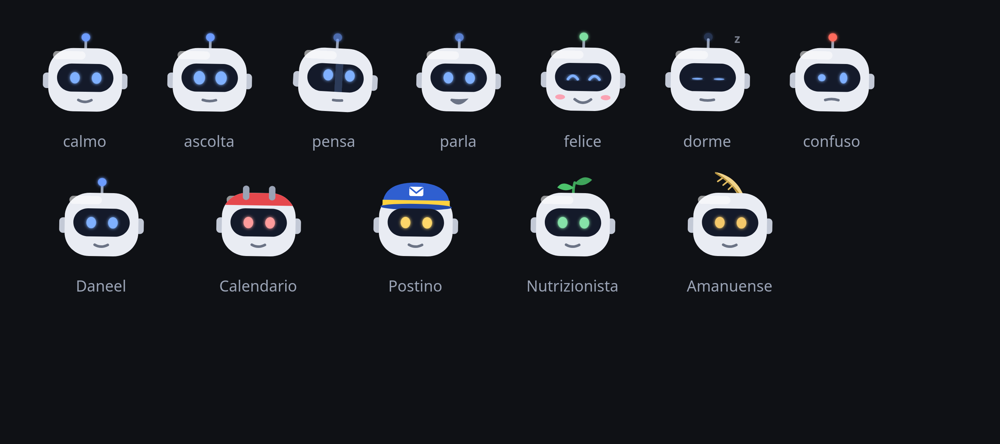</p>

## Architecture

```
iPhone (PWA)  ──HTTPS──▶  tailscale serve :8444  ──▶  uvicorn 127.0.0.1:8791 (FastAPI)
                                                        │
                                ┌───────────────────────┼─────────────────────────┐
                                ▼                       ▼                         ▼
                     claude -p --resume …        plancia.db (SQLite)        Open Food Facts
                     cwd = memory folder         + SSE live updates         (cached lookups)
                     (CLAUDE.md, skills,               ▲
                      subagents)                       │
                                │                 bin/plancia-db  ◀── skills, cron/systemd jobs
                                └──▶ bin/notifica-app, bin/avvisa-gabriele ──▶ Web Push
```

```
server/
  server.py              FastAPI app: chat, streaming, voice, photos, push, auth
  plancia.py             dashboard store (SQLite), SSE events, iCal agenda, scores endpoint
  punteggi.py            Sleep / Recovery / Strain scores
  cibo.py                Open Food Facts lookup, your own products, meal logging
  studio.py              exam study planner (material → hours → days)
  costruisci-plancia.py  builds static/plancia.html from plancia-sorgente.html
  static/                PWA: index.html (chat + tab bar), mascot, service worker, dashboard add-ons
bin/                     CLI helpers used by skills and scheduled jobs
deploy/                  systemd user units (app + nightly dashboard backup)
skills/amazon/           example skill: Amazon product search
tools/demo-dati.py       generates the fake data used for the screenshots
```

## Setup

Requirements: a Linux server with Python 3.11+, [Claude Code](https://docs.anthropic.com/en/docs/claude-code) logged in with your plan, and Tailscale on both the server and the iPhone.

```bash
git clone https://github.com/DeStalisGabriele/daneel.git ~/opt/daneel-app
cd ~/opt/daneel-app/server
python3 -m venv .venv && .venv/bin/pip install -r requirements.txt
python3 costruisci-plancia.py                 # builds static/plancia.html

# access token for the app
mkdir -p ~/.config/daneel-app && python3 -c "import secrets;print(secrets.token_urlsafe(32))" > ~/.config/daneel-app/token

# run as a user service and expose it on the tailnet
cp ../deploy/daneel-app.service ~/.config/systemd/user/   # adjust WorkingDirectory if needed
systemctl --user enable --now daneel-app
tailscale serve --bg --https 8444 http://127.0.0.1:8791
```

Then open `https://<server>.<tailnet>.ts.net:8444` in Safari, paste the token, and *Share → Add to Home Screen*. Enable notifications from the bell icon.

### Share files from any app

iOS does not list web apps in the share sheet, so sharing goes through a Shortcut. In the Shortcuts app, create one with *Show in Share Sheet* enabled and these actions:

1. **Ask for Input** (Text): a comment for Daneel.
2. **Get Contents of URL**: `https://<server>.<tailnet>.ts.net:8444/api/messaggio`, method POST, header `Authorization: Bearer <token>`, request body *Form* with:
   - `testo` (Text) = *Provided Input*
   - `file` (File) = *Shortcut Input*
   - `breve` (Text) = `1`
3. **Show Notification**: a confirmation.

With `breve=1` the server answers right away instead of streaming the reply; Daneel works on the file in the background and the answer shows up in the chat with a push notification.

Configuration (environment variables):

| Variable | Default | Meaning |
| --- | --- | --- |
| `DANEEL_DATI` | `~/.local/share/daneel-app` | chat history, uploads, dashboard database, caches |
| `DANEEL_CONFIG` | `~/.config/daneel-app` | token, VAPID keys, push subscriptions, calendar feeds |
| `DANEEL_CLAUDE` | `~/.local/bin/claude` | the Claude Code binary (point it to a fake script to test without using your plan) |
| `DANEEL_VAPID_SUB` | `mailto:daneel@example.com` | contact sent to push services: a `mailto:` address or a bare `https://host` (no path, no port) |
| `DANEEL_UNI` | `~/universita/magistrale/anno 1` | course folders read by the study planner (one folder per course, with a `TEORIA.docx` and PDFs) |

Claude Code runs in `~/claude-mind` with `--settings ~/.claude/app-settings.json`; point these at your own memory folder and permission settings. Voice transcription expects a `~/bin/trascrivi` script (e.g. whisper.cpp) that prints the text of an audio file.

### Try it with fake data

```bash
python3 tools/demo-dati.py /tmp/daneel-demo
DANEEL_DATI=/tmp/daneel-demo/dati DANEEL_CONFIG=/tmp/daneel-demo/config DANEEL_UNI=/tmp/daneel-demo/corsi \
  server/.venv/bin/uvicorn --app-dir server server:app --port 8799
```

## Notes

- This is a personal project shaped around one person's routine (Italian UI, Apple Health via Shortcuts, Hevy, Trade Republic exports). It's meant as a reference to adapt, not a polished product.
- Running `claude -p` from a web app means anyone with the token can drive an agent on your server. Keep it on a private network and tune Claude Code permissions in the settings file.

## Credits

- [Filippo Cappa](https://github.com/filippocappa), friend and fellow builder: his assistant [Aide](https://github.com/filippocappa/aide) grew out of Daneel, and this app took many ideas back from Aide (tab bar, health scores, food logging). Daneel also runs on his server. Thanks, Filippo.
- Built together with [Claude Code](https://claude.com/claude-code), as a coworker on the design and the code.
- Barcode scanning: [ZXing](https://github.com/zxing-js/library) (Apache-2.0), vendored in `server/static/vendor/`.
- Food data: [Open Food Facts](https://world.openfoodfacts.org) (ODbL).
- The name comes from R. Daneel Olivaw, Asimov's robot.

## License

[MIT](LICENSE)
